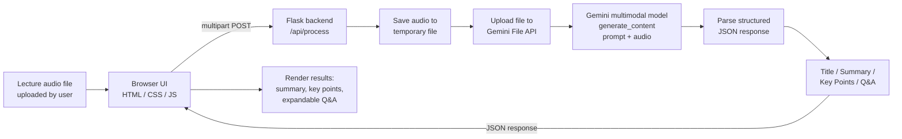

# Audio-Based Lecture Summarization and Question Generation

## 1. Title and Group Details

**Project Title:** Audio-Based Lecture Summarization and Question Generation

**College:** Kalinga Institute of Industrial Technology (KIIT)
**Branch:** Electronics and Computer Science

**Group Members:**

| Name | Roll Number | Contribution |
|------|-------------|---------------|
| G K Prudhvi Raj | 2330159 | TODO |
| Ayush Agarwal | 2330150 | TODO |

---

## 2. Problem Statement and Objectives

**Problem Statement:** Students and teachers generate large amounts of
recorded lecture audio, but reviewing it to extract the important content or
to self-test understanding is time-consuming — manual note-taking during
playback is slow, and there is no quick way to generate practice questions
from a lecture after the fact.

**Motivation:** An automated system that listens to a lecture recording and
produces a structured summary plus self-test questions saves review time and
gives students a study aid generated directly from what was actually taught,
rather than from generic textbook material.

**Objectives:**
- Accept an arbitrary recorded lecture audio file as input.
- Produce a concise title and multi-paragraph summary of the lecture content.
- Extract a bulleted list of key points covered.
- Generate 5–10 quiz questions (with answers) that test understanding of the
  material.
- Present all of this through a simple, usable web interface with no setup
  beyond an API key.

**Expected Outcome:** A working local web application where a user uploads a
lecture audio file and receives, within roughly a minute, a structured
summary and a self-quiz generated from that specific lecture.

---

## 3. Proposed Methodology and Processing Pipeline

### Block Diagram



### Stage-by-Stage Explanation

1. **Input.** The user selects a recorded lecture audio file (mp3, wav, m4a,
   etc.) in the browser and submits it via a simple HTML form.
2. **Transfer.** The frontend JavaScript sends the file as
   `multipart/form-data` to the Flask backend's `POST /api/process` route
   using the Fetch API.
3. **Temporary storage.** The Flask backend writes the uploaded bytes to a
   temporary file on disk so it can be handed to the Gemini SDK.
4. **Upload to Gemini File API.** The backend calls `genai.upload_file()`,
   which uploads the audio to Google's servers and returns a file handle the
   model can reference. This step is what lets the pipeline skip a separate
   speech-to-text model — Gemini accepts audio natively as part of a
   multimodal prompt.
5. **Generation.** A single `generate_content()` call is made with two parts:
   (a) a text prompt instructing the model to listen to the audio and
   respond with strict JSON containing a title, summary, key points, and
   5–10 quiz questions with answers, and (b) the uploaded audio file
   reference.
6. **Parsing.** The raw text response is cleaned of any markdown code fences
   and parsed as JSON. If parsing fails for any reason, the backend falls
   back to returning the raw text as the summary with empty key points/
   questions, so the request never hard-fails silently.
7. **Output.** The structured JSON (title, summary, key_points, questions) is
   returned to the browser as the HTTP response.
8. **Rendering.** The frontend JavaScript renders the title, summary
   paragraph, a bulleted key-points list, and a numbered question list where
   each answer is hidden behind a "Show answer" toggle button.

### Input, Intermediate Processing, and Output

- **Input:** a single lecture audio file (any format Gemini accepts).
- **Intermediate processing:** temporary file storage → Gemini File API
  upload → single multimodal LLM call → JSON cleaning/parsing.
- **Output:** a JSON object `{ title, summary, key_points[], questions[] }`
  rendered as a readable web page.

---

## 4. Models and Tools Used

**Model:**
- Google **Gemini** (`google/gemini-3.8-flash` by default; configurable via
  the `OPENAI_MODEL` environment variable), accessed through an
  OpenAI-compatible chat completions API exposed by a LiteLLM gateway.
- Chosen because it accepts audio as a native input modality in a single
  call, combining transcription, summarization, and question generation into
  one model invocation rather than a multi-stage pipeline (e.g. Whisper for
  transcription followed by a separate LLM for summarization).

**Libraries / Frameworks:**
- `Flask` — backend web server and routing.
- `openai` — official Python SDK, used here in OpenAI-compatible mode
  (`base_url` pointed at the LiteLLM gateway) with the `input_audio` content
  type to send base64-encoded audio directly in a chat message.
- `python-dotenv` — loads `OPENAI_API_KEY` / `OPENAI_BASE_URL` / `OPENAI_MODEL`
  from a local `.env` file.
- Plain HTML/CSS/JavaScript — no frontend framework, kept intentionally
  minimal for a single-page tool.

**Implementation Environment:**
- Python 3.9+, virtual environment (`venv`).
- Runs locally via `python3 app.py`, served on `http://127.0.0.1:5000`.

---

## 5. Implementation and Usability

**Implementation Procedure:**
1. Clone the repository and create a Python virtual environment.
2. Install dependencies from `requirements.txt`.
3. Obtain a Gemini API key from [Google AI Studio](https://aistudio.google.com/apikey)
   and place it in a `.env` file as `GEMINI_API_KEY=...`.
4. Run `python3 app.py` to start the Flask development server.
5. Open the app in a browser, upload a lecture audio file, and click
   **Summarize**.

**Running the Application:**
```bash
python3 -m venv venv
source venv/bin/activate
pip install -r requirements.txt
cp .env.example .env    # then edit .env with your real API key
python3 app.py
# visit http://127.0.0.1:5000
```

**Practical Applications:**
- Students reviewing a recorded lecture can get a quick summary and
  self-test without re-listening to the full recording.
- Teachers can generate a first draft of quiz questions from their own
  lecture recordings.
- Accessibility aid for students who find it faster to read a summary than
  to listen to a full recording.

**Usability Notes:**
- Single-page interface: upload → wait → results, no navigation required.
- Answers are hidden by default (click-to-reveal) so the output doubles as a
  self-assessment quiz, not just a reference sheet.
- No account or login needed — runs entirely locally aside from the Gemini
  API call itself.

---

## 6. Results and Sample Outputs

**Sample Input:** `samples/demo_lecture.mp3` — a real classroom lecture
recording (MIT OpenCourseWare, 7.013 Introductory Biology), ~9.5 MB, used to
validate the pipeline end-to-end.

**Sample Output** (real response from a 3-minute clip of the sample lecture,
see `demo/app_demo.mp4` for the recorded UI walkthrough of this same run):

```json
{
  "title": "Introduction to Macromolecules, Polymers, and Chemical Bonds",
  "summary": "This lecture introduces the foundational concepts of macromolecules and polymers in biochemistry. The instructor explains that macromolecules frequently consist of multiple carbon atoms bonded together, and highlights polymers as structures built from repeating sub-units known as monomers that assemble into multimers.\n\nTo grasp the structure and behavior of these complex biological molecules, an understanding of chemical bonding is essential. The lecture outlines key chemical principles governing bond formation, beginning with electronegativity, which describes an atom's relative affinity to attract electrons, and valency, which indicates the number of chemical bonds an atom can form.",
  "key_points": [
    "Macromolecules are often carbon-based structures joined together.",
    "Polymers are formed by joining individual monomers in a repeated fashion.",
    "A thorough understanding of chemical bonding is required to understand biological macromolecules.",
    "Electronegativity is an atom's relative affinity for attracting electrons.",
    "Valency refers to the number of chemical bonds an atom can form."
  ],
  "questions": [
    {
      "question": "What is the structural relationship between monomers and polymers?",
      "answer": "Polymers are formed when monomers are joined together in a repeated way."
    },
    {
      "question": "What chemical element is mentioned as typically being joined together in multiple units to form macromolecules?",
      "answer": "Carbon."
    },
    {
      "question": "What core topic is introduced as integral to understanding macromolecules throughout the course?",
      "answer": "Chemical bonds."
    },
    {
      "question": "How is electronegativity defined in the lecture?",
      "answer": "The relative affinity of a particular atom for electrons, or how strongly an atom attracts electrons."
    },
    {
      "question": "What is meant by the valency of an atom?",
      "answer": "The number of chemical bonds an atom can form."
    }
  ]
}
```

**Performance Observations:**
- A 3-minute lecture clip (783 KB mp3) returned a full result in ~12 seconds
  end-to-end.
- Processing time scales with audio length; a full 41-minute lecture did not
  return within a 2-minute client timeout in testing, suggesting a practical
  upper bound on single-request audio length with the current gateway/model
  — worth chunking longer recordings in a future iteration.
- The model reliably returns well-formed JSON for the prompt used; a
  fallback path exists for the rare case where it doesn't.

**Limitations:**
- No automatic evaluation of summary/question quality (e.g. ROUGE score
  against a reference summary) — assessment is qualitative/manual.
- Very long lectures may approach model context or file-size limits.
- Single LLM call means no retrieval-augmented grounding beyond the audio
  itself — the model cannot incorporate external course material.

---

## 7. Conclusion and Future Scope

This project demonstrates that a single multimodal LLM call — without a
separate speech-to-text stage — is sufficient to turn a raw lecture
recording into a structured summary and a set of self-test questions. The
resulting tool is lightweight (a single Flask route plus a static
HTML/CSS/JS frontend) and usable with no setup beyond an API key.

**Future Improvements:**
- In-browser microphone recording (no need to upload a pre-recorded file).
- Exportable summaries (PDF) and quizzes (e.g. Kahoot/Quizlet-compatible
  format).
- Persistent history of past lectures per user.
- Multi-language lecture support and translation.
- Automated quality scoring of generated summaries/questions.

---

## 8. References and GitHub Repository Link

**References:**
- Gemini API documentation — https://ai.google.dev/gemini-api/docs
- Gemini File API (audio understanding) — https://ai.google.dev/gemini-api/docs/audio
- Sample lecture audio: MIT OpenCourseWare, 7.013 Introductory Biology (Spring 2005), Internet Archive — https://archive.org/details/MIT7.013S05

**GitHub Repository:** https://github.com/PrudhviRajGK/MLLP-CLASS-PROJECT
