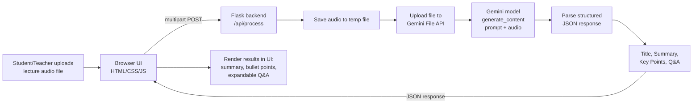

# Audio-Based Lecture Summarization and Question Generation

A web app that takes a recorded classroom lecture (audio file), and returns a
title, summary, key points, and quiz questions with answers — generated by
Google's Gemini multimodal model directly from the audio (no separate
speech-to-text step required).

## Processing Pipeline



**Stages:**
1. **Input** — user uploads an audio file (mp3/wav/m4a/etc.) through the browser.
2. **Transfer** — the file is sent as `multipart/form-data` to the Flask `/api/process` endpoint.
3. **Encode** — the backend base64-encodes the audio bytes for inline transmission.
4. **Generation** — a single chat completion call (via an OpenAI-compatible client pointed at an internal LiteLLM gateway) sends a text prompt plus the audio as an `input_audio` content block, asking the model to listen and return strict JSON containing a title, summary, key points, and 5–10 quiz questions with answers.
5. **Parsing** — the backend strips any markdown code fences and parses the JSON, with a plain-text fallback if parsing fails.
6. **Output** — the JSON is returned to the browser and rendered: summary paragraph, bullet-point key points, and a question list with click-to-reveal answers.

## Models and Tools

- **Model:** Google Gemini (`google/gemini-3.8-flash` by default, configurable via `OPENAI_MODEL` in `.env`), called through an OpenAI-compatible endpoint (`OPENAI_BASE_URL`) — chosen because it accepts audio input natively, removing the need for a separate transcription (e.g. Whisper) stage.
- **Backend:** Python 3, Flask, `openai` SDK (pointed at a LiteLLM gateway), `python-dotenv`.
- **Frontend:** Plain HTML/CSS/JavaScript (no framework) — file upload form, fetch API call, DOM rendering.

## Project Structure

```
app.py                 Flask server + Gemini integration
templates/index.html   Upload form + results UI
static/style.css       Styling
static/script.js       Upload handling + results rendering
test_app.py            Self-check for the JSON-extraction logic
samples/               Sample lecture audio for testing
requirements.txt       Python dependencies
.env.example           Environment variable template
```

## Setup & Running

```bash
python3 -m venv venv
source venv/bin/activate        # Windows: venv\Scripts\activate
pip install -r requirements.txt

cp .env.example .env
# Edit .env and set OPENAI_API_KEY / OPENAI_BASE_URL / OPENAI_MODEL for your provider or gateway

python3 app.py
# Open http://127.0.0.1:5000
```

Upload any lecture audio file (e.g. `samples/demo_lecture.mp3`, a sample MIT
OpenCourseWare biology lecture) and click **Summarize**. See `demo/app_demo.mp4`
for a recorded walkthrough.

### Running the self-check

```bash
python3 test_app.py
```

## Usability

- Works with any standard audio format Gemini accepts (mp3, wav, m4a, flac, ogg).
- No sign-up/auth required — single-user local tool, suited for students or
  teachers to quickly get a summary and self-test questions after a lecture.
- Answers are hidden by default per question and revealed on click, so it
  doubles as a self-quiz tool.

## Limitations

- No persistence — results are not saved between sessions.
- No authentication — not intended for multi-user/public deployment as-is.
- Long lectures (very large audio files) take longer to process and are
  bounded by Gemini's context/file-size limits.
- Single Gemini call per request — if generation fails or returns malformed
  JSON, the app falls back to showing raw text instead of structured results.

## Future Scope

- Support direct recording from the browser microphone.
- Add downloadable summary (PDF) and exportable quiz (e.g. Kahoot/Quizlet format).
- Persist history per user with a lightweight database.
- Multi-language lecture support.
